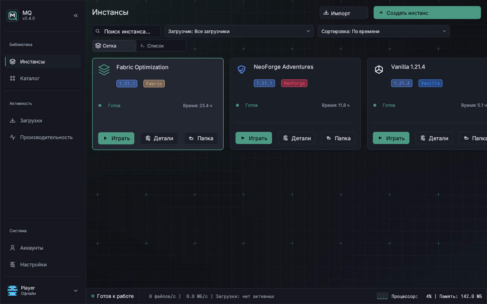
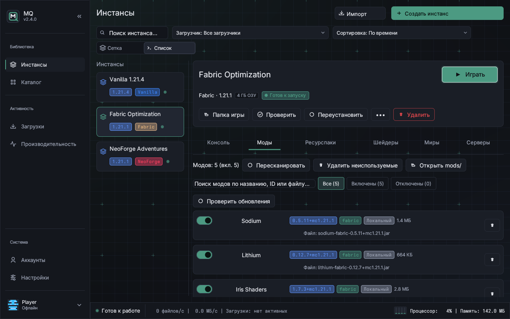
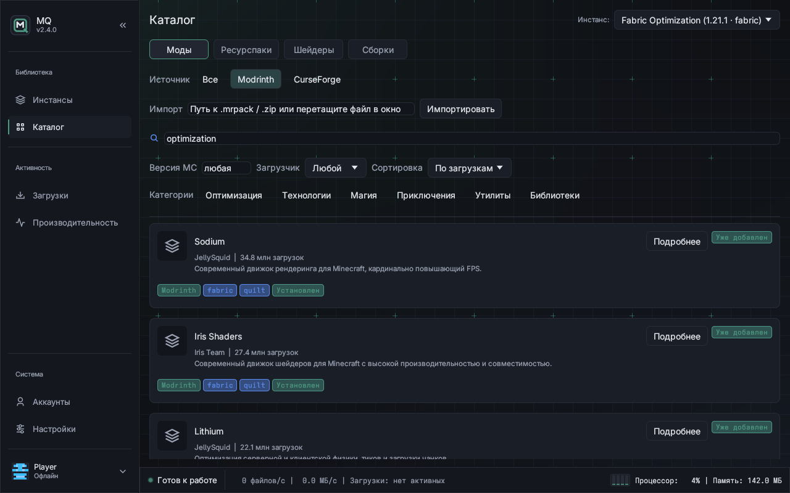
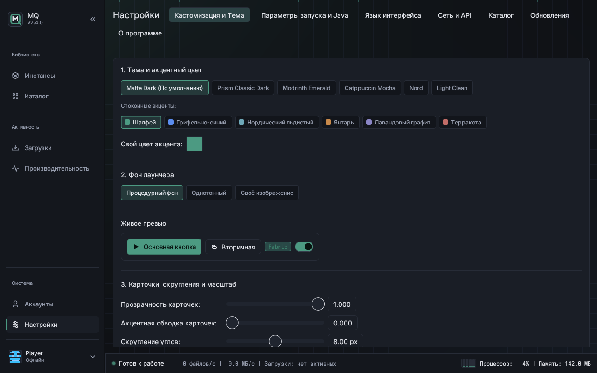
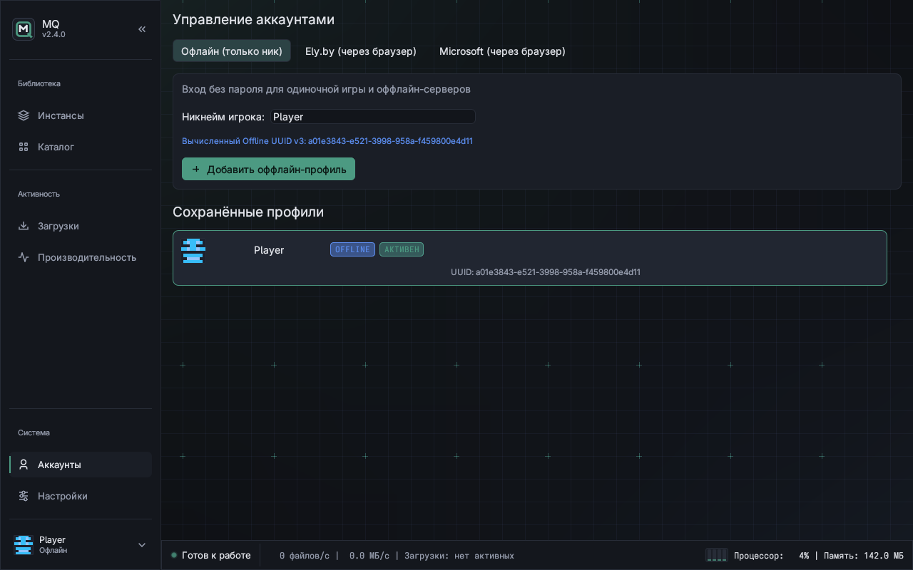
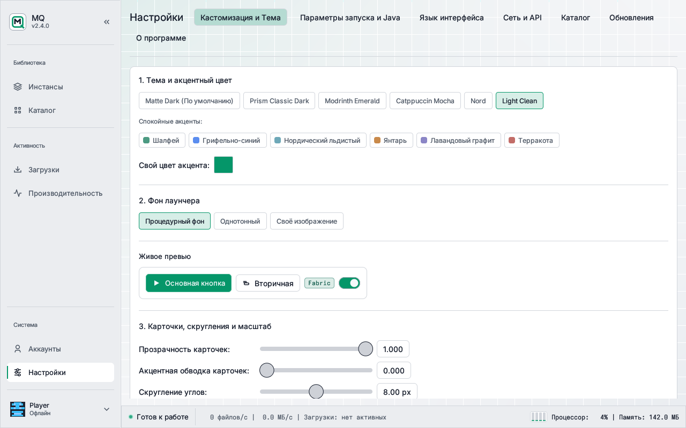

<div align="center">

<picture>
  <source media="(prefers-color-scheme: dark)" srcset="docs/assets/logo.svg">
  <source media="(prefers-color-scheme: light)" srcset="docs/assets/logo-light.svg">
  
</picture>

# MQ Launcher

Cross-platform Minecraft launcher written in Rust with isolated instances, batch mod installation, and live UI customization.

[](https://github.com/MrQuster/mq/releases)
[](https://github.com/MrQuster/mq/actions/workflows/ci.yml)
[](#installation)
[](#building-from-source)

[Русский](README.md) · **English**

[Features](#features) · [Screenshots](#screenshots) · [Installation](#installation) · [Building from Source](#building-from-source) · [Security](#security--privacy)

</div>

---

## Features

* **Isolated Instances** — separate directories (`mods/`, `resourcepacks/`, `shaderpacks/`, `config/`, `saves/`) per profile. Supports Minecraft `1.7.10` through `26.1` (`Releases`, `Snapshots`, `Beta`, `Alpha`), `Vanilla`, `Fabric`, `Quilt`, `Forge`, and `NeoForge` loaders, world backup/restore, and crash diagnostics.
* **Modrinth & CurseForge Catalog** — browse and install mods, resource packs, shaders, and modpacks, import local `.mrpack` or `.zip` packs, check updates, and search, filter, enable/disable, or delete installed content inside each instance.
* **Batch Install Queue** — queue multiple mods in the catalog, resolve and deduplicate shared required dependencies automatically, and install the entire set in one action.
* **Live UI Customization** — 6 theme presets (`Matte Dark`, `Light Clean`, `Modrinth Emerald`, `Prism Classic Dark`, `Catppuccin Mocha`, `Nord`), calm accent swatches + custom RGB picker, procedural geometric backdrop, solid color, or custom background image with dimming, plus adjustable corner radius, card opacity, scale, and density without restarting.
* **Authentication Modes** — Microsoft OAuth2 (Device Code Flow), Ely.by (OAuth2 + PKCE S256) with `authlib-injector`, and local offline profiles with skin rendering.

---

## Screenshots

<div align="center">

| Instances | Instance Mods |
| :---: | :---: |
|  |  |

| Catalog & Batch Queue | Theme Studio |
| :---: | :---: |
|  |  |

| Accounts | Light Theme |
| :---: | :---: |
|  |  |

</div>

---

## Installation

Prebuilt binaries and checksums (`SHA256SUMS` and Minisign signature `SHA256SUMS.minisig`) are published on [GitHub Releases](https://github.com/MrQuster/mq/releases).

### Windows (x64)

* **Installer:** download and run `MQ-Setup-<version>-x64.exe` from Releases (or use `install.ps1` / `packaging/winget` / `packaging/scoop` manifests).
* **Portable:** extract `mq-windows-x86_64-portable.zip` (includes `portable.flag` so configuration and instances live beside the executable).

### Linux (x86_64)

Install the latest release archive with SHA-256 verification and desktop entry setup:

```bash
curl -fsSL https://raw.githubusercontent.com/MrQuster/mq/main/install.sh | bash
```

Standalone binaries (`mq-linux-x86_64`), tarballs (`mq-linux-x86_64.tar.gz`), and Arch packaging (`packaging/PKGBUILD`) are also provided.

---

## Building from Source

Requires Rust toolchain `1.80+` (pinned in `rust-toolchain.toml`).

```bash
# 1. Clone repository
git clone https://github.com/MrQuster/mq.git
cd mq

# 2. Run desktop UI
cargo run -p mq-cli -- ui

# 3. Build release binary
cargo build --release -p mq-cli

# 4. Run verification suite
./scripts/verify.sh
```

The release binary is emitted at `target/release/mq` (`target\release\mq.exe` on Windows). System dependencies and developer workflow details are documented in [CONTRIBUTING.md](CONTRIBUTING.md).

---

## Security & Privacy

| Area | Implementation |
|---|---|
| **Telemetry** | Zero telemetry: no analytics, user tracking, or remote crash reporting. |
| **Token Storage** | Linux Secret Service / Keyring and Windows DPAPI / Credential Manager, with `0600` local fallback file permissions. |
| **Microsoft Auth** | OAuth2 Device Code Flow in the external system browser without handling passwords in-app. |
| **Ely.by Auth** | OAuth2 + PKCE S256 via external browser and local loopback listener `127.0.0.1:<port>/callback`. |
| **Archive Safety** | Zip-Slip path sanitization on extraction and automatic disabling of untrusted pre-launch commands. |
| **Release Integrity** | Minisign Ed25519 signatures, GitHub OIDC build provenance attestations, and SHA-256 checksums. |

Further reading: [SECURITY.md](docs/SECURITY.md) · [PRIVACY.md](docs/PRIVACY.md) · [THREAT_MODEL.md](docs/THREAT_MODEL.md) · [FAQ.md](docs/FAQ.md)

---

## Acknowledgements & Legal Notice

MQ builds on open specifications and community tooling from [Modrinth](https://modrinth.com/), [Ely.by](https://ely.by/), [authlib-injector](https://github.com/yushijinhun/authlib-injector), [Fabric](https://fabricmc.net/), [Quilt](https://quiltmc.org/), and [NeoForge](https://neoforged.net/). Third-party crate licenses are listed in [THIRD_PARTY_LICENSES.md](THIRD_PARTY_LICENSES.md).

Author: [MrQuster](https://github.com/MrQuster).

MQ Launcher is an independent open-source project and is not affiliated with or endorsed by Mojang Studios or Microsoft Corporation. Playing on servers with `online-mode=true` requires an official Minecraft account.
