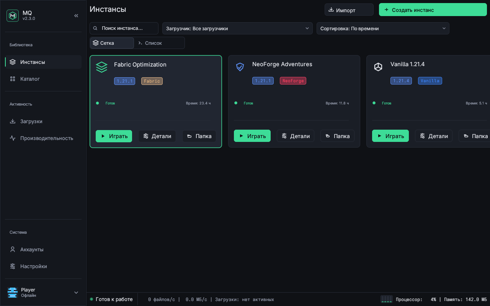
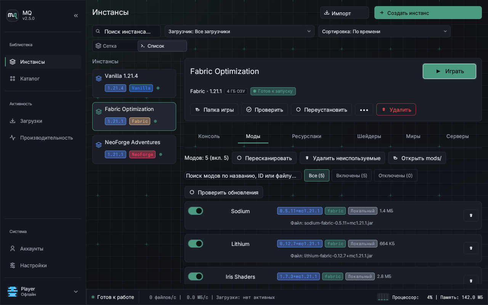
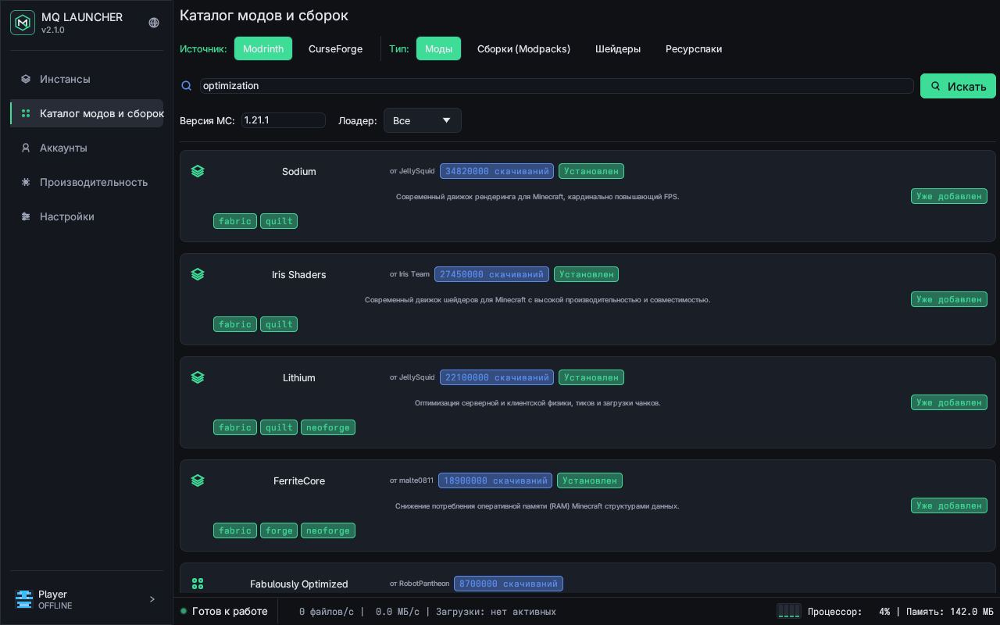
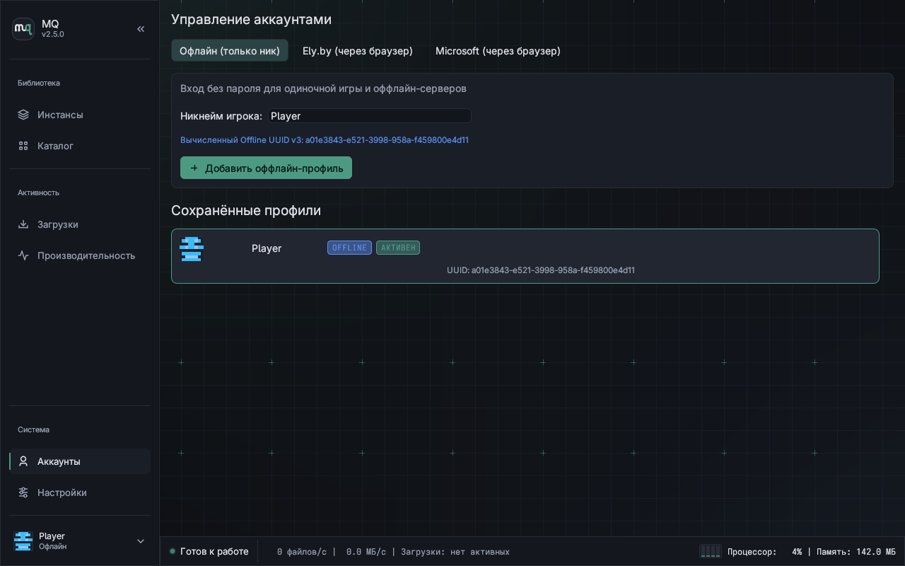
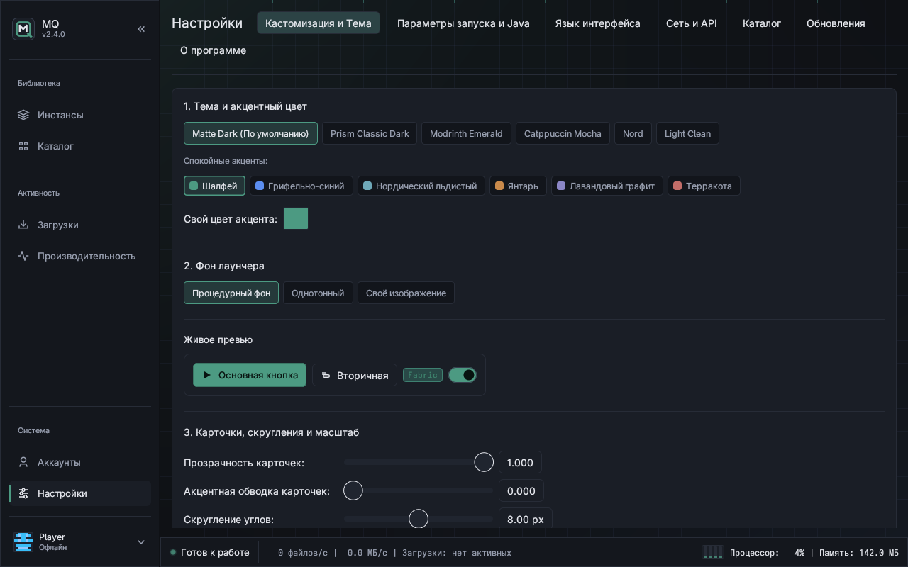
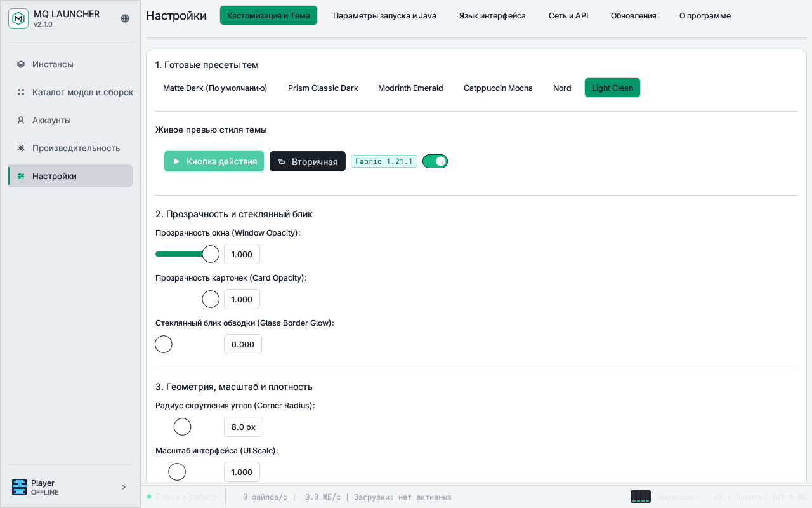

<p align="center">
  <picture>
    <source media="(prefers-color-scheme: dark)" srcset="docs/assets/logo.svg">
    <source media="(prefers-color-scheme: light)" srcset="docs/assets/logo-light.svg">
    
  </picture>
</p>

<h1 align="center">MQ</h1>

<p align="center">Лаунчер Minecraft для Linux и Windows на Rust</p>

<p align="center">
  <a href="https://github.com/MrQuster/mq/releases/latest"></a>
  <a href="https://github.com/MrQuster/mq/actions"></a>
  
</p>

<p align="center">
  <b>Русский</b> · <a href="README.en.md">English</a>
</p>

<p align="center">
  <a href="#установка">Установка</a> ·
  <a href="#возможности">Возможности</a> ·
  <a href="#скриншоты">Скриншоты</a> ·
  <a href="#быстрый-старт">Быстрый старт</a> ·
  <a href="#сборка-из-исходников">Сборка из исходников</a> ·
  <a href="#безопасность-и-приватность">Безопасность и приватность</a> ·
  <a href="docs/FAQ.md">FAQ</a>
</p>

---

MQ — модульный лаунчер для Minecraft: Java Edition, написанный на Rust. Проект ориентирован на надежность, изоляцию инстансов, высокую скорость проверки целостности файлов за счет параллельных потоков Rayon и строгий паритет функций между операционными системами Linux (Wayland / X11) и Windows 10/11 x64.

В лаунчере полностью отсутствует встроенная телеметрия, трекинг и сбор пользовательских данных.

---

## Возможности

| Категория | Поддерживаемая функциональность |
|---|---|
| **Платформы** | Linux (Wayland и X11, x86_64), Windows 10/11 x64, портативный режим работы через маркер `portable.flag`. |
| **Загрузчики модов** | Vanilla, Fabric, Quilt, Forge, NeoForge. Переключение версий загрузчика на существующем инстансе. |
| **Каталоги и модпаки** | Единый каталог Modrinth API v2 и CurseForge API v1: моды, ресурспаки, шейдеры и сборки. Разрешение зависимостей, обновления с откатом, импорт `.mrpack`, CurseForge `.zip` и MultiMC/Prism с защитой от Zip-Slip. Для CurseForge каждый пользователь указывает собственный API-ключ (Modrinth работает без ключа). |
| **Авторизация** | Офлайн-режим (детерминированный UUID v3 `OfflinePlayer:<никнейм>` по RFC 4122), Ely.by (вход через браузер по протоколу OAuth2 + PKCE S256 с автоматической инъекцией `authlib-injector`), Microsoft (Device Code Flow в браузере). |
| **Среда Java** | Автоматическое определение установленных сред OpenJDK, автозагрузка Adoptium Temurin (Java 8, 17, 21), ручной выбор пути к `java`. |
| **Хранилище CAS** | Контентно-адресуемое хранилище библиотек и ассетов с дедупликацией через жесткие ссылки (hard links) для экономии дискового пространства. |
| **Графика и шейдеры** | Управление ресурспаками и шейдерами, определение графического адаптера, автоматическая запись параметров `iris.properties` и `oculus.properties`. |
| **Интерфейс** | Графический интерфейс на `egui` / `eframe` в монолитном темном стиле без полупрозрачности (Opaque Window), чисто векторные иконки Painter, отсутствие эмодзи. |
| **Инструменты CLI** | Полнофункциональный консольный интерфейс для автоматизации: `mq launch`, `mq install`, `mq search`, `mq import`, `mq doctor`, `mq accounts`, `mq mods`, `mq self-update`. |

---

## Каталог Modrinth и CurseForge

* **Четыре типа контента:** моды, ресурспаки, шейдеры и сборки (модпаки) с фильтрацией по версии Minecraft, загрузчику, категориям и сортировкой.
* **Зависимости и обновления:** автоматический разбор обязательных и опциональных зависимостей, lock-файл `mods/.mq-lock.json` с источниками, проверка обновлений и откат при сбое.
* **Локальный импорт:** поддержка `.mrpack`, CurseForge `.zip` и архивов MultiMC/Prism (через кнопку «Импорт», drag-and-drop в окно или `mq import <файл>`). Команды pre/post-launch из импортируемых архивов игнорируются; при распаковке действуют проверки от Zip-Slip, симлинков и zip-бомб.
* **Ключ API CurseForge:** в релизные сборки не вшивается общий ключ. Modrinth работает сразу без ключа; для CurseForge каждый пользователь вводит свой бесплатный ключ в **Настройки → Каталог** (или задаёт переменную окружения `MQ_CURSEFORGE_API_KEY`).
* **Файлы с ограниченным распространением:** если автор проекта на CurseForge запретил автоматическое скачивание сторонними лаунчерами (`downloadUrl == null`), MQ не обходит это ограничение, а открывает страницу загрузки в браузере и автоматически подхватывает скачанный файл из папки загрузок.

---

## Скриншоты

<p align="center">
  
  
</p>
<p align="center">
  
  
</p>
<p align="center">
  
  
</p>

---

## Установка

### Linux

Установка актуального релиза скриптом в одну команду:

```bash
curl -fsSL https://github.com/MrQuster/mq/releases/latest/download/install.sh | sh
```

Портативный запуск без установки в систему:

```bash
curl -LO https://github.com/MrQuster/mq/releases/download/v2.4.0/mq-linux-x86_64.tar.gz
tar -xzf mq-linux-x86_64.tar.gz
./mq
```

### Windows 10 / 11 x64

Установка через PowerShell в одну команду (права администратора UAC не требуются):

```powershell
irm https://github.com/MrQuster/mq/releases/latest/download/install.ps1 | iex
```

| Способ установки | Команда / файл | Примечание |
|---|---|---|
| **Установщик Inno Setup 6** | [`MQ-Setup-2.4.0-x64.exe`](https://github.com/MrQuster/mq/releases/download/v2.4.0/MQ-Setup-2.4.0-x64.exe) | Ставится в `%LOCALAPPDATA%\Programs\MQ` без UAC, RU/UK/EN, ассоциация `.mrpack` |
| **PowerShell-скрипт** | `irm https://github.com/MrQuster/mq/releases/latest/download/install.ps1 \| iex` | Проверка `SHA256SUMS` и Minisign, поддержка `-Portable`, `-Silent`, `-Uninstall` |
| **Портативный архив** | [`mq-windows-x86_64-portable.zip`](https://github.com/MrQuster/mq/releases/download/v2.4.0/mq-windows-x86_64-portable.zip) | С `portable.flag`, хранит все данные в папке `data/` рядом с `mq.exe` |
| **winget** | `winget install MrQuster.MQ` | Официальный манифест в `packaging/winget/` |
| **Scoop** | `scoop install packaging/scoop/mq.json` | Портативная сборка с `persist: ["data"]` |

Проверка подписи, контрольных сумм SHA-256 и информация о Windows SmartScreen описаны в [docs/WINDOWS_SIGNING.md](docs/WINDOWS_SIGNING.md).

Подробная информация для Arch Linux, Ubuntu/Debian и Fedora доступна в [Руководстве по установке](docs/INSTALL.md).

---

## Быстрый старт

1. **Запустите лаунчер:**
   ```bash
   mq
   ```
2. **Добавьте профиль:**
   Во вкладке **«Аккаунты»** выберите удобный способ входа: локальный офлайн-режим, аккаунт Ely.by либо Microsoft.
3. **Создайте инстанс:**
   Нажмите кнопку **«Создать»**, укажите имя инстанса, версию Minecraft и необходимый загрузчик (например, 1.21.1 + Fabric).
4. **Установите моды (опционально):**
   Откройте вкладку **«Каталог»** или перетащите `.mrpack` / `.jar` файлы в окно лаунчера.
5. **Нажмите «Играть»:**
   Лаунчер проверит наличие ассетов, библиотек и исполняемой среды Java, после чего запустит игру.

---

## Сборка из исходников

Для сборки требуется компилятор Rust (стабильная версия 1.80+):

```bash
# 1. Клонирование репозитория
git clone https://github.com/MrQuster/mq.git
cd mq

# 2. Сборка оптимизированного релизного бинарного файла
cargo build --release

# 3. Запуск тестов
cargo test --workspace
```

Исполняемый файл будет расположен по пути `target/release/mq` (или `target/release/mq.exe` на Windows).

Подробная информация о системных библиотеках и разработке приведена в документе [CONTRIBUTING.md](CONTRIBUTING.md).

---

## Безопасность и приватность

| Параметр | Реализация в MQ Launcher |
|---|---|
| **Телеметрия** | Полное отсутствие (0 аналитических запросов, 0 трекинга, 0 логов на удаленные серверы). |
| **Хранение токенов** | Системный интерфейс Secret Service / Keyring в Linux, DPAPI / Credential Manager в Windows. Локальный файл учетных данных защищен маской прав `0600`. |
| **Авторизация Microsoft** | Официальный протокол OAuth2 Device Code Flow через внешний браузер без ввода пароля в приложении. |
| **Авторизация Ely.by** | Протокол OAuth2 + PKCE S256 через системный браузер и локальный loopback-сервер `127.0.0.1:<port>/callback`. |
| **Защита архивов** | Встроенный фильтр Zip-Slip и блокировка относительных путей при распаковке модов и модпаков. Деактивация небезопасных сторонних скриптов запуска. |
| **Цепочка поставок** | Цифровая подпись релизов Minisign Ed25519, аттестация происхождения GitHub OIDC Sigstore и хэши SHA-256. |

Подробнее о политиках безопасности:
* [Политика безопасности (SECURITY.md)](docs/SECURITY.md)
* [Политика приватности (PRIVACY.md)](docs/PRIVACY.md)
* [Модель угроз (THREAT_MODEL.md)](docs/THREAT_MODEL.md)

---

## Часто задаваемые вопросы

Ответы на вопросы о путях расположения данных, смене версий Java, шейдерах, фильтре SmartScreen и обновлении собраны в [docs/FAQ.md](docs/FAQ.md).

---

## Благодарности

Проект использует технологии и опирается на открытые разработки сообщества:
* **[Modrinth](https://modrinth.com/)** — современная открытая платформа модов и спецификация формата `.mrpack`.
* **[Ely.by](https://ely.by/)** — независимая система скинов и открытый сервис авторизации.
* **[authlib-injector](https://github.com/yushijinhun/authlib-injector)** — агент для безопасного перенаправления авторизации в среде JVM.
* **[Mojang Studios](https://www.minecraft.net/)** — создатели Minecraft.
* **[Fabric](https://fabricmc.net/)** и **[Quilt](https://quiltmc.org/)** — модульные и быстрые загрузчики модификаций.

Сведения о лицензиях всех используемых сторонних библиотек и компонентов приведены в документе [THIRD_PARTY_LICENSES.md](THIRD_PARTY_LICENSES.md).

---

## Автор

* **MrQuster** — [MrQuster](https://github.com/MrQuster)

---

## Юридическая оговорка

MQ является независимым проектом с открытым исходным кодом и не связан с Mojang Studios, Microsoft Corporation или их дочерними структурами. Minecraft является зарегистрированным товарным знаком Mojang Studios.

Для игры на серверах с включенной проверкой подлинности (`online-mode=true`) требуется официальный лицензионный аккаунт. Ely.by является независимым сообществом и не связано с Mojang Studios. Проект MQ не использует и не распространяет проприетарные ресурсы, текстуры или зарегистрированные торговые марки Minecraft.
