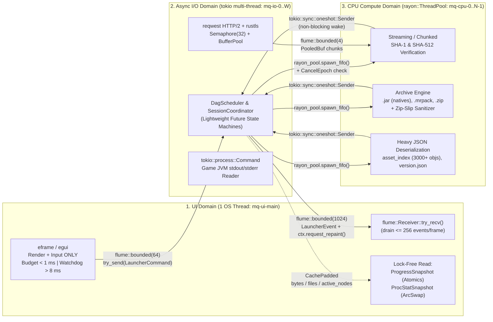
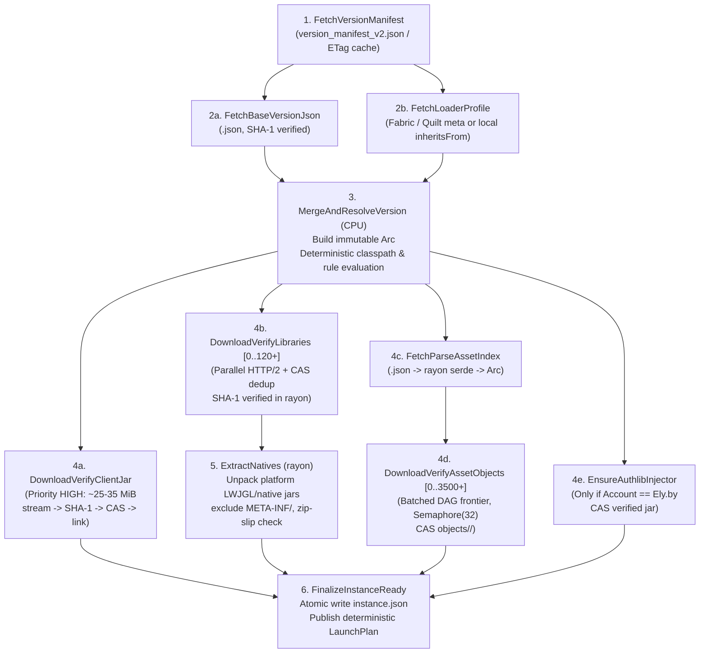
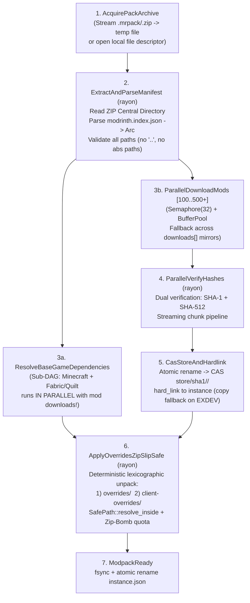
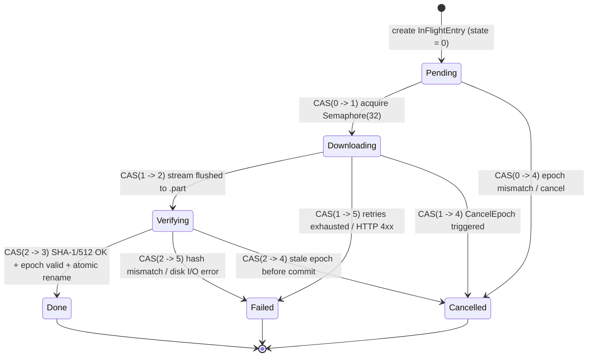
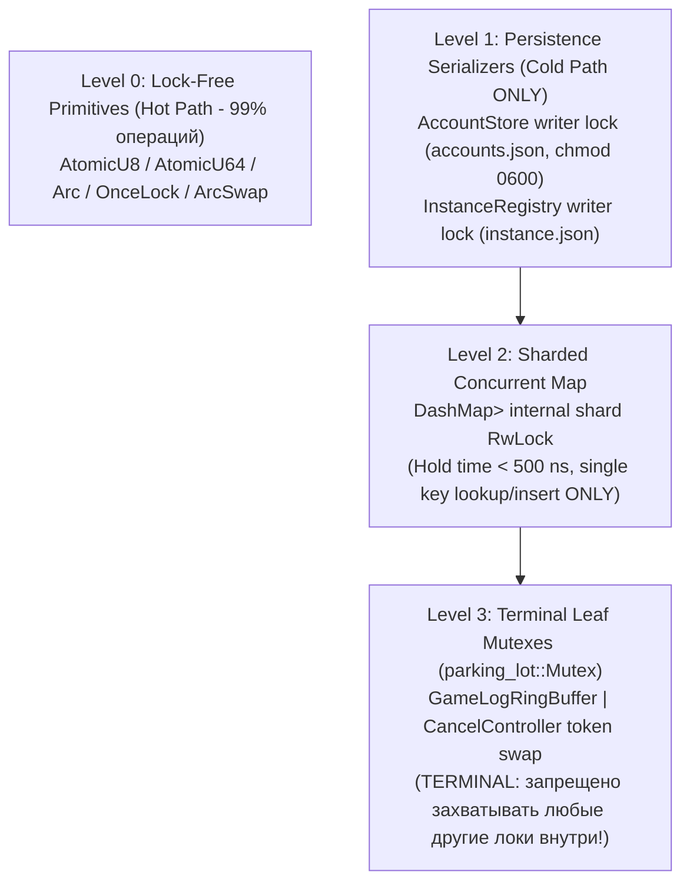
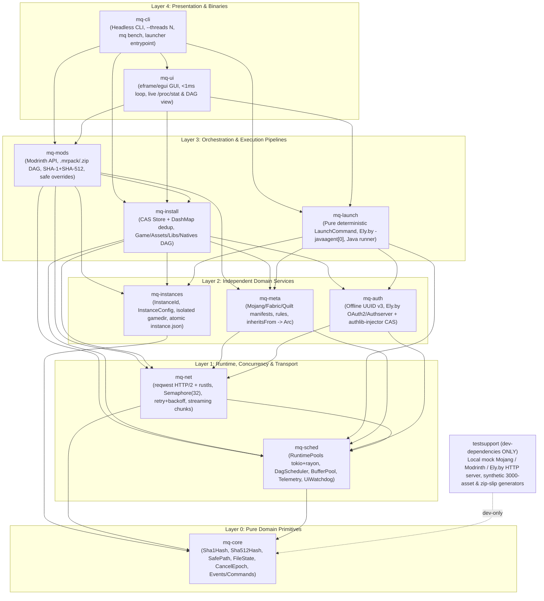

# Архитектура многопоточного лаунчера Minecraft `MQ`

> **Статус документа:** Нормативная спецификация архитектуры до написания функционального кода (**Урок E5 — Architecture Before Code**).  
> **Целевая платформа:** Linux (`x86_64` / `aarch64`), Rust Workspace (Edition 2021/2024).  
> **Ключевые инварианты системы:**
> - **UI-поток никогда не блокируется:** целевой бюджет `egui::App::update()` `< 1 мс`, сторожевой таймер `UiWatchdog` логирует `WARN` при `> 8 мс` (**E1**).
> - **Отсутствие CPU Oversubscription:** строгое разделение `UI (1)` + `tokio Async I/O` + `rayon CPU (--threads N)` без единого `block_on` внутри пулов (**E2**).
> - **Shared-Nothing и отсутствие глобального мьютекса:** иммутабельные `Arc`-снапшоты + шардированный `DashMap` + строгая иерархия локов без удержания guard через `.await` и I/O (**E3**).
> - **Жёсткий бюджет памяти:** пиковое потребление `VmRSS ≤ 256 МиБ` за счёт `BufferPool`, `Semaphore(32)`, ограниченных каналов `flume::bounded` и потоковой обработки файлов (**E4**).
> - **Мгновенная атомарная отмена:** монотонная эпоха `CancelEpoch` (`AtomicU64` + `CancellationToken`) и машина состояний файла с коммитом через `fsync + rename` (**E6**).
> - **Наблюдаемость первого класса:** фазовая телеметрия DAG, `/proc/stat` по ядрам, контроль RSS и расчёт последовательной доли по закону Амдала (**E7**, **E9**).
> - **100% детерминизм:** `classpath`, оверрайды, аргументы JVM/игры, `-javaagent` для Ely.by и Offline UUID v3 побайтово идентичны при `--threads 1` и `--threads N` (**E8**).

---

## 1. Топология потоков и отсутствие CPU Oversubscription (Уроки E1, E2)

Главный антипаттерн классических лаунчеров — либо запуск сетевых/дисковых операций в потоке окна, либо спавн сотен потоков ОС (`std::thread::spawn` / бесконтрольный `tokio::task::spawn_blocking` до 512 потоков), либо выполнение SHA-1/SHA-512 и распаковки ZIP прямо на воркерах асинхронного реактора. В `MQ` среда исполнения жёстко разделена на **три изолированных домена потоков**.

### 1.1. Схема доменов исполнения и мостов взаимодействия



### 1.2. Спецификация пулов потоков

| Домен | Механизм и размер пула | Имена потоков ОС | Разрешённые операции | Строго запрещённые операции |
| :--- | :--- | :--- | :--- | :--- |
| **UI Thread** | Главный поток процесса (`eframe` event loop), ровно `1` поток | `mq-main-ui` | Обработка ввода, вёрстка виджетов `egui`, `try_recv` из канала событий (не более `256` за кадр), чтение атомарных счётчиков прогресса, `try_send` команд пользователя | Любой файловый/сетевой I/O (`std::fs`, сокеты), блокирующий `recv()`, хеширование, парсинг больших JSON, захват разделяемых с I/O мьютексов |
| **Async I/O Pool** | `tokio::runtime::Builder::new_multi_thread()`, `worker_threads = clamp(nproc / 2, 2, 4)` | `mq-io-{0..W-1}` | Сетевой мультиплексированный I/O (`epoll`), таймеры ретраев, чтение пайпов процесса игры, координация переходов `DagScheduler`, запись подготовленных чанков | Хеширование SHA-1/SHA-512, распаковка `.zip`/`.jar`/`.mrpack`, тяжёлый `serde_json::from_slice`, массовый вызов `tokio::task::spawn_blocking` |
| **CPU Compute Pool** | `rayon::ThreadPoolBuilder::new().num_threads(threads)`, где `threads` задаётся `--threads N` (по умолчанию `available_parallelism()`, fallback `4`) | `mq-cpu-{0..N-1}` | Верификация `SHA-1` и `SHA-512`, чтение и распаковка архивов `.jar`/`.mrpack`/`.zip`, валидация путей архивов, парсинг крупных манифестов | `Handle::block_on(...)`, сетевые запросы, ожидание на асинхронных примитивах, спавн дополнительных неуправляемых `std::thread::spawn` |

### 1.3. Мост `tokio <-> rayon` без блокировок (`mq-sched::bridge`)

Передача вычислительной задачи из асинхронного контекста `tokio` в пул `rayon` реализуется исключительно через неблокирующую отправку замыкания и пробуждение `Future` по `tokio::sync::oneshot`:

```rust
pub async fn spawn_cpu<F, T>(
    pool: &rayon::ThreadPool,
    epoch_ctx: EpochContext,
    work: F,
) -> Result<T, SchedError>
where
    F: FnOnce(&EpochContext) -> Result<T, SchedError> + Send + 'static,
    T: Send + 'static,
{
    epoch_ctx.check()?; // Быстрый отказ до постановки в очередь
    let (tx, rx) = tokio::sync::oneshot::channel();

    pool.spawn_fifo(move || {
        // Если операцию отменили, пока задача лежала в очереди rayon — выходим за ~10 нс
        let outcome = match epoch_ctx.check() {
            Ok(()) => work(&epoch_ctx),
            Err(cancelled) => Err(cancelled),
        };
        // oneshot::Sender::send никогда не блокирует поток rayon!
        let _ = tx.send(outcome);
    });

    // Задача tokio уступает поток исполнителю (Poll::Pending), пока rayon считает
    tokio::select! {
        biased;
        _ = epoch_ctx.cancelled() => Err(SchedError::Cancelled(epoch_ctx.epoch_id())),
        res = rx => res.map_err(|_| SchedError::CpuWorkerPanicked)?,
    }
}
```

Для потоковой верификации крупных скачиваемых файлов на лету между `tokio`-загрузчиком и `rayon`-верификатором используется ограниченный канал `flume::bounded::<PooledBuf>(4)`: сетевая задача пушит `rx.send_async(buf).await`, а воркер `rayon` обрабатывает пачку готовых чанков либо выполняет финальную верификацию без блокировки воркеров `tokio`.

**Абсолютный запрет:**
1. Внутри `rayon` **запрещён** `tokio::runtime::Handle::block_on` (риск взаимной блокировки пулов и скрытого простоя CPU-ядер на сетевом ожидании).
2. Внутри `tokio` **запрещён** синхронный `std::sync::mpsc::Receiver::recv` или `flume::Receiver::recv` (замораживает реактор сокетов).
3. В UI-потоке связь с фоном идёт только через `flume::Receiver::try_recv()` + обратный сигнал `RepaintCallback` (`egui::Context::request_repaint()`), коалесцированный через `AtomicBool` (`repaint_pending`) с частотой не выше `60 Гц` для прогресса и мгновенно — при смене состояния фазы. В состоянии покоя UI-поток спит в композиторе окна и потребляет `0% CPU`.

### 1.4. Почему в этой топологии нет CPU Oversubscription

CPU Oversubscription возникает не от количества созданных в процессе дескрипторов потоков `pthread`, а тогда, когда число **одновременно готовых к исполнению (`TASK_RUNNING`)** потоков $R(t)$ устойчиво превышает число аппаратных потоков процессора $C = \text{nproc}$, вызывая вытесняющие переключения контекста планировщика ядра Linux (EEVDF/CFS), сброс конвейера и вымывание кэшей L1/L2.

В нашей архитектуре выполняется строгий инвариант $R(t) \le N$ почти на всём интервале работы:
1. **Фаза насыщения сети (I/O-bound):** воркеры `tokio` проводят `> 95%` времени в системном вызове `epoll_wait(2)` в состоянии `TASK_INTERRUPTIBLE`, просыпаясь на микросекунды для чтения готовых байт из буфера ядра TCP в `PooledBuf`. Свободные от задач потоки `rayon` паркуются на `futex_wait` и потребляют `0% CPU`.
2. **Фаза насыщения вычислений (CPU-bound: хеширование 3000+ объектов, распаковка `.mrpack`):** ровно $N$ потоков `rayon` загружают $N$ ядер на `100%`. Как только буферы `BufferPool` и ограниченные каналы `flume::bounded` заполняются, задачи `tokio` приостанавливаются на `.await` семафора/пула, чтение из сокетов ставится на паузу, окно приёма TCP (TCP Receive Window) закрывается естественным механизмом ядра, и все потоки `tokio` уходят в `epoll_wait`. Конкуренции между `tokio` и `rayon` за ядра не возникает.
3. **Режим однопоточного эталона (`--threads 1`):** `rayon` создаётся ровно с `1` рабочим потоком, а семафор параллельных задач конвейера ограничивает активную CPU-обработку одним потоком, обеспечивая честную базовую точку отсчёта $T(1)$ для закона Амдала.

---

## 2. Графы задач (DAG) и критический путь (Урок E9)

Планировщик `DagScheduler` (`mq-sched`) представляет каждую операцию установки как ориентированный ациклический граф $G = (V, E)$. Узел $v \in V$ хранит атомарный счётчик неразрешённых зависимостей `in_degree: AtomicUsize`. Как только предок $u$ успешно завершается, он делает `fetch_sub(1, Ordering::AcqRel)` у всех потомков $(u \to v) \in E$; потомок, чей счётчик достиг `0`, **немедленно** отправляется на исполнение без ожидания глобальных барьеров между несвязанными ветками.

### 2.1. DAG установки игры (Vanilla / Fabric / Quilt / `inheritsFrom`)



### 2.2. DAG установки модпака (`.mrpack` Modrinth / `.zip`)



### 2.3. Что остаётся последовательным на критическом пути и почему (Урок E9)

Согласно **закону Амдала**, даже при бесконечном числе ядер ускорение ограничено величиной $1/s$, где $s$ — доля строго последовательной работы на критическом пути графа $T_{\text{crit}}$. В `MQ` последовательными остаются **только фундаментальные информационные зависимости**, которые невозможно устранить без нарушения криптографической целостности или протокола форматов:

1. **`version_manifest_v2.json` $\to$ `version.json`:** URL и эталонный `SHA-1` конкретного `version.json` содержатся внутри корневого манифеста Mojang. *Смягчение в MQ:* локальный кэш манифестов с проверкой свежести и мгновенным хитом по `SHA-1` при повторных установках (`< 1 мс`).
2. **`version.json` (+ `loader_profile`) $\to$ старт скачивания файлов:** список библиотек, URL `client.jar` и URL `asset_index.json` неизвестны до парсинга и разрешения правил ОС/архитектуры. *Смягчение в MQ:* `FetchBaseVersionJson` и `FetchLoaderProfile` выполняются параллельно, а слияние в памяти занимает `< 2 мс`.
3. **`asset_index.json` $\to$ `asset_objects[0..3500+]`:** хеши 3500 звуков, локализаций и иконок перечислены только внутри `asset_index.json`. *Смягчение в MQ:* пока скачивается и парсится `asset_index.json`, **уже идут** параллельные загрузки `client.jar`, 100+ библиотек и `authlib-injector.jar`! Таким образом, ожидание индекса ассетов маскируется полезной сетевой работой других веток.
4. **Архив `.mrpack` $\to$ `modrinth.index.json` $\to$ моды:** формат ZIP размещает Central Directory в самом конце файла, поэтому до получения архива модпака извлечь манифест со списком модов нельзя. *Смягчение в MQ:* сразу после чтения манифеста подграф установки базовой игры (`Minecraft + Fabric/Quilt`) и скачивание 500 модов запускаются **одновременно**, а не друг за другом.
5. **`CasStoreAndHardlink` $\to$ `ApplyOverridesZipSlipSafe` $\to$ `Ready`:** оверрайды модпака обязаны применяться строго поверх созданной структуры каталогов и после линковки файлов манифеста, чтобы пользовательские конфигурации из `client-overrides/` гарантированно имели финальный приоритет и не были затёрты фоновыми воркерами.
6. **Приоритизация `LPT` (Longest Processing Time First):** чтобы в конце параллельной фазы один крупный файл (`client.jar` на 30 МиБ или тяжёлый мод на 50 МиБ) не создавал «длинный однопоточный хвост» на графике загрузки ядер, планировщик сортирует готовые задачи скачивания по убыванию известного `size_bytes`. Крупные артефакты получают слоты `Semaphore(32)` первыми, а мелкие ассеты (по 4–32 КиБ) плотно заполняют оставшуюся полосу параллельно с ними.

---

## 3. Таблица владения данными (Shared-Nothing + Immutability, Урок E3)

В `MQ` **полностью отсутствует** антипаттерн `Arc<Mutex<LauncherState>>`. Вместо разделяемого мутабельного состояния применяются три архитектурных механизма:
1. **Иммутабельные снапшоты (`Arc<T>`):** конструируются один раз в локальной памяти воркера, запечатываются в `Arc` и раздаются сотням задач для чтения без единого лока (`0` атомарных записей на чтении, идеальная локальность кэша CPU).
2. **Шардированная таблица дедупликации (`DashMap`):** координирует конкурирующие запросы к одному и тому же блобу CAS по ключу `Sha1Hash` за $O(1)$.
3. **Каналы сообщений и кэш-выровненные атомики:** связывают UI и оркестратор без разделяемых коллекций.

### 3.1. Полная таблица владения ключевыми структурами

| Данные / Структура | Точный тип в Rust | Создатель / Мутатор | Читатели | Синхронизация | Инвариант безопасности |
| :--- | :--- | :--- | :--- | :--- | :--- |
| Разрешённый профиль версии игры | `Arc<ResolvedVersion>` | Узел `MergeAndResolveVersion` (`mq-meta`) | `mq-install`, `mq-launch`, `mq-ui` | Иммутабельный `Arc` (read-only после создания) | Никогда не мутируется после публикации; содержит предвычисленный порядок `libraries` |
| Индекс ассетов (3000–5000 записей) | `Arc<AssetIndex>` | Узел `FetchParseAssetIndex` (`mq-meta` в `rayon`) | Воркеры `mq-install` | Иммутабельный `Arc`; хеши хранятся inline как `Sha1Hash([u8; 20])` | Ноль аллокаций строк для хешей, нулевая конкуренция при параллельном чтении |
| Манифест модпака | `Arc<ModpackIndex>` | Узел `ExtractAndParseManifest` (`mq-mods` в `rayon`) | `mq-mods`, `mq-install`, `mq-ui` | Иммутабельный `Arc` | Все относительные пути провалидированы через `SafePath` на этапе парсинга |
| Реестр активных и завершённых CAS-загрузок | `Arc<DashMap<Sha1Hash, Arc<InFlightEntry>>>` | Воркеры `mq-install` / `mq-mods` | Все воркеры загрузки и CAS | 64 шарда `DashMap` + `AtomicU8` и `tokio::sync::Notify` внутри `InFlightEntry` | Шард-лок `DashMap` удерживается `< 500 нс` только для клонирования `Arc<InFlightEntry>`, никогда через `.await` |
| Эпоха отмены | `Arc<CancelController>` (`AtomicU64` + `Mutex<CancellationToken>`) | Оркестратор сессии по команде UI/CLI | Каждый сетевой, дисковый и CPU-воркер | `AtomicU64` (`Acquire`/`SeqCst`) + `CancellationToken` | Монотонное возрастание `epoch`; устаревшие воркеры отсекаются без координации |
| Пул буферов памяти | `Arc<BufferPool>` | `mq-sched` при старте | `mq-net`, `mq-install`, `mq-mods` | `Semaphore(max_chunks)` + `crossbeam_queue::ArrayQueue<BytesMut>` | Жёсткий потолок `32 МиБ`; `Drop` у `PooledBuf` автоматически возвращает буфер в очередь |
| Метрики прогресса в реальном времени | `Arc<ProgressCounters>` | Воркеры `tokio` и `rayon` | `mq-ui` (каждый кадр), `mq-cli` | Поля обёрнуты в `CachePadded<AtomicU64>` (`Relaxed`/`Release`) | Разнесение по 64-байтным кэш-линиям исключает **false sharing** между ядрами |
| Снапшот телеметрии ядер CPU и фаз | `Arc<ArcSwap<TelemetrySnapshot>>` | Фоновый сэмплер `ProcStatSampler` (раз в 250 мс) | `mq-ui`, `mq-cli` | Lock-free `arc_swap::ArcSwap` | UI читает консистентный срез всех ядер за пару инструкций без единого мьютекса |
| Команды управления | `flume::Sender<LauncherCommand>` / `Receiver` | Продюсер: `mq-ui` / `mq-cli` | Консьюмер: `SessionCoordinator` | `flume::bounded(64)` | UI использует `try_send`; очередь команд никогда не блокирует рендер |
| События жизненного цикла | `flume::Sender<LauncherEvent>` / `Receiver` | Продюсер: `SessionCoordinator` | Консьюмер: `mq-ui` / `mq-cli` | `flume::bounded(1024)` | Передаёт смены фаз, логи и ошибки; высокочастотный байтовый прогресс идёт через `ProgressCounters` |
| Состояние виджетов интерфейса | `UiState` (обычный `struct`, `!Sync`) | Только главный поток `mq-ui` | Только главный поток `mq-ui` | Не требуется (Single-Thread Ownership) | Принадлежит стеку потока `eframe`, физически недоступен фоновым потокам |

### 3.2. O(1) Дедупликация In-Flight и CAS через `DashMap`

При установке нескольких инстансов, библиотек или ассетов (в Minecraft сотни звуковых/языковых файлов в `AssetIndex` часто ссылаются на **один и тот же `SHA-1`** под разными виртуальными путями!) дедупликация работает за $O(1)$ без глобальной блокировки:

```rust
pub struct InFlightEntry {
    pub sha1: Sha1Hash,
    pub state: AtomicU8, // FileState
    pub epoch: AtomicU64,
    pub finished: tokio::sync::Notify,
    pub last_error: std::sync::OnceLock<Arc<InstallError>>,
}
```

1. Воркер проверяет наличие файла в CAS (`store/sha1/<xx>/<sha1>`). Если файл уже существует и его размер совпадает с манифестом — мгновенный `cas_hit` без обращения к сети.
2. Иначе воркер заглядывает в `inflight: &DashMap<Sha1Hash, Arc<InFlightEntry>>` внутри короткого синхронного блока `{ ... }`, клонирует `Arc<InFlightEntry>` и **немедленно освобождает шард `DashMap`**.
3. Первый воркер, переведший `state` из `Pending` в `Downloading` через `compare_exchange`, выполняет скачивание, потоковую верификацию и атомарный коммит в CAS, после чего переводит состояние в `Done` и вызывает `finished.notify_waiters()`.
4. Все параллельные воркеры с тем же `Sha1Hash` ждут на `entry.finished.notified().await` (с `tokio::select!` на свой `EpochContext::cancelled()`) и сразу по сигналу линкуют готовый блоб из CAS в свои целевые пути. Ни байта лишнего трафика и ни одного лишнего прохода SHA-1.

---

## 4. Машина состояний файла и эпохи отмены (`CancelEpoch`, Урок E6)

### 4.1. Атомарная машина состояний `FileState`

Состояние каждого обрабатываемого объекта кодируется в `AtomicU8` с переходами исключительно через `compare_exchange(expected, next, Ordering::AcqRel, Ordering::Acquire)`:



| Код (`u8`) | Состояние | Семантика и допустимые действия |
| :---: | :--- | :--- |
| `0` | `Pending` | Узел зарегистрирован, ожидает слота семафора или проверки CAS |
| `1` | `Downloading` | Один владеющий воркер стримит чанки во временный файл `.part` |
| `2` | `Verifying` | Воркер `rayon` завершает криптографическую сверку `SHA-1` / `SHA-512` и `sync_data()` |
| `3` | `Done` | Файл атомарно переименован в CAS, неизменяем, доступен для `hard_link` |
| `4` | `Cancelled` | Задача прервана сменой `CancelEpoch`; временный `.part`-файл удалён |
| `5` | `Failed` | Исчерпаны ретраи или обнаружено несовпадение хеша; ошибка записана в `OnceLock` |

### 4.2. Механизм эпох отмены (`CancelEpoch`) и защита от «зомби-записи»

Простого булева флага `AtomicBool` для отмены недостаточно: если пользователь нажал «Отмена» (переход `true`) и через 50 мс снова нажал «Установить» (переход обратно в `false`), запоздавший воркер первой сессии в `rayon` может проснуться, увидеть `cancelled == false` и затереть файлы новой сессии!

Поэтому в `MQ` вводится строго монотонный счётчик эпох **`CancelEpoch`**:
1. `CancelController` хранит `current_epoch: AtomicU64` (инициализируется `1`).
2. Каждая новая операция получает неизменяемый снапшот `epoch_id = controller.next_epoch()` (`fetch_add(1, Ordering::SeqCst)`) и привязанный к этой эпохе дочерний `CancellationToken`.
3. При нажатии «Отмена» или закрытии окна вызывается `controller.cancel_active()`: счётчик `current_epoch` инкрементируется, а `CancellationToken` мгновенно будит все ожидающие `tokio::select!` (таймеры ретраев, чтение сокетов, ожидание семафора, ожидание `oneshot` от `rayon`).
4. Все временные файлы включают номер эпохи и идентификатор задачи:
   `<cas_root>/tmp/<sha1_hex>.e<epoch_id>.t<task_id>.part`
   Даже если старый воркер ещё завершает системный вызов `write(2)` в ядре ОС, его файл физически изолирован по имени от новой сессии `e<epoch_id + 1>`.
5. **Двухфазный протокол публикации с барьером эпохи:**
   ```rust
   // Внутри воркера после успешной проверки SHA-1 / SHA-512 и temp_file.sync_data()?
   if epoch_ctx.is_stale() {
       let _ = std::fs::remove_file(&temp_path);
       entry.try_transition(FileState::Verifying, FileState::Cancelled);
       return Err(InstallError::Cancelled(epoch_ctx.epoch_id()));
   }
   // POSIX rename(2) на одной файловой системе атомарен
   std::fs::rename(&temp_path, &cas_blob_path)?;
   entry.try_transition(FileState::Verifying, FileState::Done);
   ```
   И на следующем шаге (линковка из CAS в директорию конкретного инстанса и обновление `instance.json`) `epoch_ctx.is_stale()` проверяется повторно. Устаревший воркер **ни при каком расписании потоков ядра** не может модифицировать состояние инстанса новой эпохи. При старте лаунчера и после каждой отмены `TempJanitor` очищает каталог `<cas_root>/tmp/*.part`.

---

## 5. Иерархия локов и инварианты синхронизации (Урок E3)

Для математического исключения взаимных блокировок (AB-BA deadlocks) и деградации параллелизма вводится строгая трёхуровневая иерархия блокировок. Захват разрешён **только строго сверху вниз (`Level 1 -> Level 2 -> Level 3`)**.



### 5.1. Жёсткие правила работы с блокировками (Enforced by Architecture & Lints)

1. **Запрет удержания любого лока через `.await`, системный I/O или UI-коллбэк:**
   Ни один guard (`parking_lot::MutexGuard`, `RwLockReadGuard`, `RwLockWriteGuard`, `dashmap::mapref::one::Ref`, `RefMut`) не имеет права жить в области видимости во время:
   - любой точки приостановки `.await`;
   - операций `std::fs::*`, `File::read/write/sync_data`, сетевых вызовов;
   - отправки в заполненный синхронный канал или вызова внешнего замыкания.
2. **Запрет двойного обращения к `DashMap` в одном скоупе:**
   Если поток удерживает `Ref` или `RefMut` на ключ $k_1$ в `DashMap` и пытается обратиться к ключу $k_2$, попавшему по хешу в тот же шард, возникает мгновенный deadlock на внутреннем `RwLock` шарда. Поэтому любое обращение к `DashMap` обязано быть обёрнуто в минимальный лексический блок `{ ... }`, возвращающий скопированное значение или `Arc::clone`.
3. **Запрет `std::sync::Mutex`:**
   Во всех крейтах для синхронных листовых структур используется исключительно `parking_lot::Mutex` (компактнее в памяти, не вызывает каскадных паник из-за lock poisoning).
4. **Статический гейт компилятора в корневом `Cargo.toml`:**
   ```toml
   [workspace.lints.clippy]
   await_holding_lock = "deny"
   await_holding_refcell_ref = "deny"
   mutex_atomic = "warn"
   ```

---

## 6. Backpressure и бюджет памяти (`≤ 256 МиБ RSS`, Урок E4)

Параллельная загрузка 3500 ассетов или 500 модов без сквозного обратного давления (backpressure) мгновенно раздувает кучу до 1–2 ГиБ из-за буферизации целых `.jar`-файлов в `Vec<u8>` и неограниченных очередей `unbounded_channel`. В `MQ` пиковый `VmRSS` процесса жёстко ограничен **`≤ 256 МиБ`** на любых объёмах модпаков.

### 6.1. Распределение бюджета памяти (`256 МиБ` Ceiling)

```text
+-------------------------------------------------------------------------+ 256 MiB (Hard Gate)
| Свободный запас прочности (Safety Headroom)                    ~95 MiB  |
+-------------------------------------------------------------------------+ 161 MiB (Design Peak)
| Аллокатор ОС + окна deflate flate2 (N * 32 KiB) + пики JSON    ~40 MiB  |
| UI Domain: egui font/icon atlas + vertex buffers + 5k log ring ~24 MiB  |
| Иммутабельные индексы: ResolvedVersion + AssetIndex ([u8; 20]) ~12 MiB  |
| Каналы flume::bounded + очереди NodeId планировщика DAG         ~1 MiB  |
| HTTP/2 сокеты reqwest + rustls (Semaphore = 32 соединения)     ~16 MiB  |
| BufferPool: 256 переиспользуемых чанков по 128 KiB (HARD CAP)   32 MiB  |
| Код бинарника + стеки потоков (1 UI + 4 IO + N CPU * 2 MiB)    ~36 MiB  |
+-------------------------------------------------------------------------+ 0 MiB
```

### 6.2. Четыре контура Backpressure

1. **Сетевой контур (`HttpSemaphore`):** `tokio::sync::Semaphore::new(32)` ограничивает число одновременно открытых потоков загрузки HTTP/2. Остальные 3400+ задач в `DagScheduler` представлены только легковесными дескрипторами `NodeId(u32)` и не выделяют сетевых буферов до получения permit.
2. **Буферный контур (`BufferPool`):**
   - Пул предварительно аллоцирует / ограничивает максимум `256` буферов фиксированной ёмкости `128 КиБ` (допустимый диапазон настройки `64 КиБ`–`256 КиБ`, суммарный лимит `32 МиБ`).
   - Воркер обязан вызвать `let mut buf = buffer_pool.acquire(&epoch_ctx).await?;` перед чтением сетевого потока или распаковкой файла.
   - Обёртка `PooledBuf` реализует `Drop`: при выходе из области видимости (включая ранний выход по `?` или отмене `CancelEpoch`) буфер очищается (`buf.clear()`, сохраняя выделенную capacity) и возвращается в lock-free очередь `ArrayQueue`, освобождая слот семафора пула.
   - Если диск не успевает сбрасывать страницы или `rayon` занят верификацией, свободные `PooledBuf` заканчиваются, `acquire().await` приостанавливает чтение из сокетов, и потребление памяти физически не может вырасти выше лимита пула.
3. **Канальный контур (`flume::bounded` ONLY):**
   В кодовой базе запрещён вызов `unbounded()` для любых рабочих данных (`#[deny(clippy::disallowed_methods)]` на `tokio::sync::mpsc::unbounded_channel` и `flume::unbounded`).
4. **Потоковая обработка без чтения файлов целиком (`Zero Whole-File Reads`):**
   - **Скачивание + хеширование:** один и тот же чанк `128 КиБ` прокачивается по конвейеру `Socket -> Sha1::update(&chunk) [+ Sha512::update(&chunk)] -> File::write_all(&chunk)` и сразу переиспользуется для следующего куска. Файл на `300 МиБ` требует ровно `128 КиБ` ОЗУ.
   - **Распаковка `.mrpack` / `.zip` / `natives.jar`:** архив открывается через файловый дескриптор `std::fs::File` (произвольный доступ `Read + Seek` к Central Directory без загрузки архива в память), а извлечение каждого файла выполняется потоковым циклом чтения чанками из `BufferPool` с контролем квоты распакованных байт (защита от **zip-bomb**).
   - **Компактное представление хешей:** вместо `String` на 40 символов (`24` байта заголовка `String` + `40` байт в куче + оверхед аллокатора = `~80 байт`) используется `#[repr(transparent)] pub struct Sha1Hash(pub [u8; 20]);` (`Copy`, `Eq`, `Hash`, `Ord`, ровно `20 байт` на стеке/в массиве без единой аллокации).

---

## 7. Детерминизм исполнения (Урок E8)

Параллелизм ускоряет доставку и проверку байтов на диск, но **никогда не должен влиять на итоговую конфигурацию инстанса или команду запуска игры**.

### 7.1. Золотое правило детерминизма `MQ`

> Для любого фиксированного набора манифестов, настроек инстанса и учётной записи структура `LaunchCommand` (`executable`, `jvm_args`, `classpath`, `main_class`, `game_args`, `env`), а также содержимое директории инстанса после установки модпака обязаны быть **побайтово идентичны** при запуске с `--threads 1`, `--threads 4`, `--threads 16` и при произвольном порядке завершения сетевых запросов.

### 7.2. Механизмы обеспечения детерминизма

1. **Разделение фазы параллельной материализации и фазы сборки `classpath`:**
   Воркеры загрузки **не пушат** скачанные библиотеки в общий `Mutex<Vec<PathBuf>>` по мере готовности. Порядок элементов `classpath` вычисляется детерминированно ещё на шаге `MergeAndResolveVersion` в виде иммутабельного среза `ResolvedVersion::libraries: Vec<ResolvedLibrary>`, а параллельный этап лишь гарантирует, что к моменту перехода в `Ready` все файлы по этим путям лежат на диске и прошли `SHA-1`.
2. **Детерминированное слияние `inheritsFrom` и переопределение библиотек (Fabric / Quilt):**
   - Каждая библиотека сопоставляется по ключу координаты Maven **без версии**: `(group_id, artifact_id, classifier_opt, rules_signature)`.
   - При наследовании профиля модлоадера от базовой версии (`inheritsFrom`, например Fabric Loader поверх Vanilla `1.20.4`):
     1. Сначала в порядке объявления в `loader_profile.libraries` добавляются библиотеки загрузчика.
     2. Затем в порядке объявления в `base_version.libraries` добавляются библиотеки базовой игры; если библиотека с тем же ключом `(group_id, artifact_id, classifier_opt)` уже была объявлена загрузчиком (например, обновлённый `org.ow2.asm:asm`), версия базовой игры **детерминированно подавляется** (loader override wins) без дублирования разных версий одного JAR в `classpath`.
     3. Завершающим элементом `classpath` строго последним всегда ставится `client.jar`.
     4. `mainClass` берётся из дочернего профиля загрузчика (`net.fabricmc.loader.impl.launch.knot.KnotClient` / `org.quiltmc.loader.impl.launch.knot.KnotClient`), а аргументы JVM и игры конкатенируются в порядке `base_args -> loader_args`.
3. **Запрет недетерминированных хеш-таблиц при сериализации и генерации аргументов:**
   Везде, где порядок обхода ключей влияет на CLI-флаги, порядок распаковки или JSON на диске, вместо `std::collections::HashMap` (использующего случайный сид `RandomState`) применяется строго упорядоченный `std::collections::BTreeMap`.
4. **Лексикографический порядок применения `overrides` модпака:**
   Записи архива `.mrpack` фильтруются, нормализуются в `SafePath`, сортируются по каноническому UTF-8 пути и распаковываются строго в два детерминированных прохода: сначала все файлы из `overrides/`, затем поверх них все файлы из `client-overrides/` (приоритет клиентских оверрайдов по спецификации Modrinth).
5. **Правило первого аргумента JVM для Ely.by (`Authlib-Injector`):**
   При запуске с аккаунтом `AccountKind::ElyBy` в вектор аргументов JVM **строго на индекс `0`** (до `-Xmx`, `-Djava.library.path`, специфичных для ОС флагов и пользовательских аргументов!) детерминированно помещается агент:
   ```text
   -javaagent:<canonical_path_to_authlib_injector.jar>=https://account.ely.by/api/authlib-injector
   ```
   Это гарантирует перехват загрузки классов `com.mojang.authlib` до инициализации любых трансформеров модлоадеров (Mixin / Fabric / Quilt).
6. **Детерминированный расчёт Offline UUID v3:**
   Для оффлайн-профиля с никнеймом `nick` вычисляется стандартный совместимый с серверами Minecraft UUID v3 (`MD5("OfflinePlayer:" + nick)` по RFC 4122):
   ```rust
   pub fn offline_uuid_v3(nickname: &str) -> uuid::Uuid {
       let mut hasher = md5::Md5::new();
       hasher.update(b"OfflinePlayer:");
       hasher.update(nickname.as_bytes());
       let mut bytes: [u8; 16] = hasher.finalize().into();
       bytes[6] = (bytes[6] & 0x0f) | 0x30; // Version 3 (MD5 namespace/name)
       bytes[8] = (bytes[8] & 0x3f) | 0x80; // Variant RFC 4122
       uuid::Uuid::from_bytes(bytes)
   }
   ```

---

## 8. Метрики, профилирование и телеметрия (Уроки E7, E9)

Оптимизация без объективных замеров запрещена (**Урок E7**). Подсистема `mq-sched::telemetry` собирает метрики с наносекундными накладными расходами и экспортирует их как в живую панель `mq-ui`, так и в машиночитаемый JSON/табличный отчёт `mq-cli`.

### 8.1. Набор собираемых метрик

1. **Фазовые метрики DAG (`PhaseTelemetry`):**
   Точное время старта и длительность (`Duration`) каждой фазы (`manifest_fetch`, `version_resolve`, `asset_index`, `parallel_download_verify`, `natives_or_overrides`, `finalize`), количество обработанных файлов и байт, число попаданий в CAS (`cas_hits`) и число срабатываний in-flight дедупликации (`dedup_hits`).
2. **Пропускная способность в реальном времени:**
   Скользящие окна (интервал сэмплирования `250 мс`, окно усреднения `1000 мс`) для **`files/sec`**, **`MiB/sec`**, текущего числа активных узлов `active_dag_nodes` и глубины очереди готовых узлов `ready_queue_len`.
3. **Мониторинг памяти процесса (`RssSampler`):**
   Чтение `/proc/self/status` (`VmRSS` и пикового `VmHWM` от ядра Linux) в стек-буфер без аллокаций. Если `VmRSS` приближается к порогу предупреждения (`220 МиБ`) или нарушает инвариант `256 МиБ`, фиксируется диагностический флаг телеметрии и ассерт в бенчмарках.
4. **Сторожевой таймер кадра `UiWatchdog`:**
   На каждом вызове `eframe::App::update()` замеряется чистое время работы UI-потока $\Delta t_{\text{ui}}$:
   - Целевая норма: $\Delta t_{\text{ui}} < 1\text{ мс}$.
   - Порог инцидента: если $\Delta t_{\text{ui}} > 8\text{ мс}$, атомарный счётчик `watchdog_spikes` увеличивается на `1`, обновляется `max_ui_frame_us`, и пишется `tracing::warn!(frame_ms = ..., drained_events = ..., "UiWatchdog threshold exceeded (>8ms)")`.

### 8.2. По-ядерная загрузка CPU по дельтам `/proc/stat`

Сэмплер `ProcStatSampler` каждые `250 мс` читает первые строки `cpu0 .. cpu{C-1}` из `/proc/stat` в фиксированный буфер на стеке `[u8; 8192]`. Для каждого аппаратного потока $i \in [0, C-1]$ парсятся счётчики квантов времени ядра (`USER_HZ`):
`user`, `nice`, `system`, `idle`, `iowait`, `irq`, `softirq`, `steal` *(поля `guest` и `guest_nice` в Linux уже учтены внутри `user` и `nice`, повторно не суммируются)*.

$$\text{Idle}_i = \text{idle}_i + \text{iowait}_i$$
$$\text{Active}_i = \text{user}_i + \text{nice}_i + \text{system}_i + \text{irq}_i + \text{softirq}_i + \text{steal}_i$$
$$\text{Total}_i = \text{Idle}_i + \text{Active}_i$$

По двум последовательным замерам $t_0$ и $t_1$:
$$\Delta \text{Total}_i = \text{Total}_i(t_1) - \text{Total}_i(t_0), \qquad \Delta \text{Idle}_i = \text{Idle}_i(t_1) - \text{Idle}_i(t_0)$$

$$\text{CpuLoad}_i(\%) = \begin{cases} 0.0, & \text{если } \Delta \text{Total}_i = 0 \\ 100.0 \times \dfrac{\Delta \text{Total}_i - \Delta \text{Idle}_i}{\Delta \text{Total}_i}, & \text{если } \Delta \text{Total}_i > 0 \end{cases}$$

Срез всех ядер публикуется в `ArcSwap<ProcStatSnapshot>`, откуда UI рисует живые столбики загрузки каждого ядра без единого системного вызова в потоке рендеринга.

### 8.3. Закон Амдала и эмпирическая оценка последовательной доли $s$

По закону Амдала теоретическое ускорение $S(N)$ для задачи с последовательной долей $s \in [0, 1]$ на $N$ потоках равно:

$$S(N) = \frac{T(1)}{T(N)} = \frac{1}{s + \frac{1 - s}{N}}, \qquad \lim_{N \to \infty} S(N) = \frac{1}{s}$$

Команда `mq bench` (и интеграционный бенчмарк в `benches/`) прогоняет идентичную детерминированную установку против локального высокоскоростного сервера фикстур `testsupport` при `--threads 1` ($T(1)$) и `--threads N` ($T(N)$, $N > 1$), после чего вычисляет **эмпирическую последовательную долю Карпа—Флатта** $s_{\text{emp}}$:

$$s_{\text{emp}} = \frac{\dfrac{1}{S(N)} - \dfrac{1}{N}}{1 - \dfrac{1}{N}}, \qquad S_{\max}^{\text{emp}} = \frac{1}{\max(s_{\text{emp}}, \varepsilon)}$$

Одновременно планировщик DAG считает **структурную долю критического пути** $s_{\text{dag}} = \dfrac{T_{\text{crit}}}{\sum_{v \in V} T_{\text{work}}(v)}$. Сопоставление двух величин служит автоматическим детектором скрытых узких мест:
- если $s_{\text{emp}} \approx s_{\text{dag}}$ и мала — параллелизм масштабируется близко к теоретическому оптимуму графа;
- если $s_{\text{emp}} \gg s_{\text{dag}}$ — в коде присутствует неучтённое ожидание на локах (**E3**), oversubscription (**E2**) или узкое горлышко одного потока записи.

---

## 9. Матрица уроков E1–E9 и критерии верификации

| Код | Урок (ошибка многопоточности из видео) | Архитектурное правило в `MQ` | Крейт / Модуль / Типы | Эмпирический гейт верификации |
| :-: | :--- | :--- | :--- | :--- |
| **E1** | **Блокировка главного (UI) потока** сетевыми запросами, диском, парсингом или ожиданием мьютекса | UI-поток выполняет только ввод и рендер (`< 1 мс`); связь строго через `flume::Receiver::try_recv` (лимит 256/кадр) + атомарные счётчики + `request_repaint()` | `mq-ui`, `mq-sched::watchdog::UiWatchdog` | Тест симуляции шторма из 10 000 обновлений прогресса: `0` блокирующих вызовов в `mq-ui`, `UiWatchdog` подтверждает `frame_time <= 8 ms` |
| **E2** | **Oversubscription, спавн тысяч потоков и CPU-работа внутри async-реактора** («больше потоков $\neq$ быстрее») | Разделение `1 UI` + `tokio I/O (2..4)` + `rayon CPU (--threads N)`. Мост через `rayon::spawn_fifo` + `tokio::sync::oneshot`, запрет `block_on` в пулах | `mq-sched::pools::RuntimePools`, `mq-sched::bridge::spawn_cpu` | Инспекция числа потоков `/proc/self/task` под нагрузкой 3500 файлов (константно и предсказуемо); grep/lint на отсутствие `block_on` внутри библиотечных крейтов |
| **E3** | **Глобальный мьютекс, конкуренция за локи, дедлоки и удержание лока через `.await`/I/O** | Shared-Nothing + иммутабельные `Arc<ResolvedVersion>`, `Arc<AssetIndex>`, `Arc<ModpackIndex>`; `DashMap` O(1) для CAS; строгая иерархия `L1 -> L2 -> L3` | `mq-core`, `mq-install::cas::CasStore`, `Cargo.toml` lints | `cargo clippy --workspace -- -D clippy::await_holding_lock`; стресс-тест 64 конкурентных установок пересекающихся артефактов без дедлоков |
| **E4** | **Отсутствие backpressure, безразмерные очереди и взрыв памяти (OOM)** при параллельном чтении файлов в `Vec<u8>` | Жёсткий бюджет `VmRSS ≤ 256 МиБ`: `Semaphore(32)`, `BufferPool` (`256 * 128 КиБ = 32 МиБ`), только `flume::bounded`, потоковые SHA-1/512 и распаковка ZIP | `mq-sched::bufpool::BufferPool`, `mq-net::StreamDownloader`, `mq-mods` | Интеграционный бенчмарк установки 3000+ ассетов и крупного `.mrpack` проверяет пиковый `VmHWM / VmRSS <= 256 MiB` по `/proc/self/status` |
| **E5** | **Попытка «прикрутить многопоточность потом»** поверх готового мутабельного однопоточного кода | **Architecture First:** фиксация топологии потоков, DAG, таблицы владения, `Send`/`Sync` границ и контрактов крейтов в `docs/ARCHITECTURE.md` до написания кода | `/home/honey/mq/docs/ARCHITECTURE.md`, границы модулей всех 12 крейтов | Наличие полного `ARCHITECTURE.md` до коммитов бизнес-логики; отсутствие циклических зависимостей в `cargo metadata` |
| **E6** | **Сломанная отмена, «зомби-потоки» и повреждение файлов на диске** при прерывании или быстром перезапуске | Атомарная машина `FileState` (`Pending -> Downloading -> Verifying -> Done \| Failed \| Cancelled`) + монотонная эпоха `CancelEpoch` + `.e<epoch>.part` + `fsync` + `rename` | `mq-core::epoch::CancelController`, `mq-core::state::FileState`, `mq-install` | Хаос-тест: 20 циклов `Start -> Cancel (через случайные 5..50 мс) -> Restart` подряд: `0` битых файлов в CAS/инстансе, `0` утечек `.part`-файлов |
| **E7** | **Оптимизация «вслепую» без профилирования и воспроизводимых замеров** | Встроенная телеметрия длительности фаз, `files/sec`, `MiB/sec`, `/proc/stat` по ядрам, `VmRSS`, `UiWatchdog` и локальный стенд сравнения `1` vs `N` потоков | `mq-sched::telemetry`, `mq-cli bench`, `benches/`, `testsupport` | Автоматический прогон `mq bench --threads 1` vs `mq bench --threads N` выводит валидный JSON/табличный отчёт с ускорением $S(N) > 1$ и метриками ядер |
| **E8** | **Недетерминизм результата** из-за гонок за порядок завершения потоков | Полная независимость `classpath`, `inheritsFrom`, оверрайдов `.mrpack`, первого флага `-javaagent` (Ely.by) и Offline UUID v3 от числа потоков и таймингов сети | `mq-meta::resolve`, `mq-launch::command`, `mq-auth`, `mq-mods::overrides` | Property/интеграционный тест: сравнение `LaunchCommand` и дерева файлов инстанса после установки с `--threads 1` и `--threads 8` (со случайным сетевым джиттером) даёт 100% побайтовое совпадение |
| **E9** | **Игнорирование закона Амдала и последовательного критического пути** | Явный `DagScheduler` без лишних фазовых барьеров, параллельный старт веток после `version.json`, параллельная установка игры и модов в `.mrpack`, приоритет `LPT`, расчёт $s_{\text{emp}}$ | `mq-sched::dag::DagScheduler`, `mq-install`, `mq-mods`, `AmdahlReport` | Телеметрия подтверждает перекрытие веток во времени и рассчитывает $s_{\text{emp}}$ и теоретический потолок $1/s_{\text{emp}}$ |

---

## 10. Контракты между крейтами Workspace (Ациклический граф из 12 крейтов)

Workspace разделён на **5 строгих архитектурных слоёв** (плюс изолированный тестовый крейт `testsupport` исключительно в `[dev-dependencies]`). Любая зависимость направлена строго сверху вниз — циклические зависимости невозможны по построению.

### 10.1. Граф зависимостей крейтов Workspace



### 10.2. Публичные контракты и зоны ответственности крейтов

1. **`mq-core` (Layer 0 — нулевые внутренние зависимости):**
   - Хеш-типы фиксированного размера: `Sha1Hash([u8; 20])`, `Sha512Hash([u8; 64])` с парсингом/форматированием hex без лишних аллокаций.
   - Защита файловой системы: `SafePath::resolve_inside(base: &Path, untrusted_rel: &str) -> Result<PathBuf, PathSecurityError>` (отклоняет абсолютные пути, компоненты `..`, NUL-байты, Windows-префиксы дисков и выход через симлинки — единый барьер от **Zip-Slip** для всех крейтов).
   - Конкурентные примитивы состояния: `FileState`, `CancelEpoch`, `EpochContext`, `CancelController`.
   - Контракты шины сообщений: `LauncherCommand`, `LauncherEvent`, единая иерархия ошибок и XDG-пути (`~/.local/share/mq`, `~/.config/mq`, `~/.cache/mq`).

2. **`mq-sched` (Layer 1 — зависит от `mq-core`):**
   - `RuntimePools`: инициализация и владение `tokio::Runtime` и `rayon::ThreadPool` с конфигурацией `--threads N`.
   - `bridge::spawn_cpu`: безопасный мост `tokio <-> rayon` с проверкой `EpochContext`.
   - `DagScheduler`: описание узлов, разрешение зависимостей по `AtomicUsize`, приоритетная очередь `LPT` по размеру задач.
   - `BufferPool` и `PooledBuf`: управление бюджетом чанков памяти (`≤ 32 МиБ`).
   - `telemetry`: `ProgressCounters` (`CachePadded<AtomicU64>`), `ProcStatSampler` (`/proc/stat`), `RssSampler` (`/proc/self/status`), `AmdahlReport` и `UiWatchdog`.

3. **`mq-net` (Layer 1 — зависит от `mq-core`, `mq-sched`):**
   - `HttpClient`: обёртка над `reqwest::Client` (`rustls-tls`, HTTP/2 adaptive window, таймауты connect/read, User-Agent `mq-launcher/<version>`).
   - `StreamDownloader`: ограничение параллелизма `Semaphore(32)`, ретраи сетевых сбоев и `HTTP 429/5xx` с экспоненциальным backoff + детерминируемым/ограниченным jitter, потоковая запись в `File` через `BufferPool` с обновлением потоковых хешеров и мгновенным прерыванием по `EpochContext`.

4. **`mq-meta` (Layer 2 — зависит от `mq-core`, `mq-sched`, `mq-net`):**
   - Клиенты и кэш метаданных Mojang (`piston-meta.mojang.com`), Fabric Meta (`meta.fabricmc.net`) и Quilt Meta (`meta.quiltmc.org`).
   - Вычисление правил `OsRule` / `FeatureRule`, детерминированное слияние `inheritsFrom` с подавлением дублей координат Maven и выпуск иммутабельных `Arc<ResolvedVersion>` и `Arc<AssetIndex>`.

5. **`mq-auth` (Layer 2 — зависит от `mq-core`, `mq-sched`, `mq-net`):**
   - `OfflineAuthProvider`: валидация никнейма и чистая функция `offline_uuid_v3(nick)`.
   - `ElyByAuthProvider`: аутентификация/обновление/валидация токенов против `https://authserver.ely.by` / OAuth2 `account.ely.by` (включая корректную обработку двухфакторных кодов `2FA` и запрет попадания токенов/паролей в `Debug` и `tracing` через тип `SecretString`).
   - `AuthlibInjectorManager`: доставка и верификация `authlib-injector.jar` в CAS и генерация обязательного первого аргумента JVM `-javaagent:<jar>=https://account.ely.by/api/authlib-injector`.
   - `AccountStore`: хранение профилей в `~/.config/mq/accounts.json` с атомарной перезаписью и правами доступа `0600` (`rw-------`).

6. **`mq-instances` (Layer 2 — зависит от `mq-core`):**
   - CRUD-операции над изолированными экземплярами игры (`InstanceId`, `InstanceConfig`: версия MC, тип и версия загрузчика, лимиты памяти `-Xms`/`-Xmx`, кастомные флаги JVM, путь к Java, привязанный модпак).
   - Атомарное обновление `instance.json` (`write temp -> sync_all -> rename`) под сериализатором `Level 1`.

7. **`mq-install` (Layer 3 — зависит от `mq-core`, `mq-sched`, `mq-net`, `mq-meta`, `mq-instances`, `mq-auth`):**
   - `CasStore`: глобальное контентно-адресуемое хранилище блобов по `Sha1Hash`, шардированная дедупликация `DashMap<Sha1Hash, Arc<InFlightEntry>>`, материализация файлов в инстансе и общем каталоге `assets/objects/<xx>/<sha1>` через `std::fs::hard_link` с автоматическим потоковым `copy` при `EXDEV`, а также `TempJanitor`.
   - `GameInstaller`: сборка и исполнение полного DAG установки игры (раздел 2.1), включая параллельную распаковку `natives` в `rayon` с фильтрацией `exclude`.

8. **`mq-mods` (Layer 3 — зависит от `mq-core`, `mq-sched`, `mq-net`, `mq-meta`, `mq-instances`, `mq-install`):**
   - Клиент API Modrinth v2 (поиск модпаков/модов, выбор совместимых версий).
   - `ModpackInstaller`: исполнение полного DAG установки `.mrpack` и `.zip` (раздел 2.2) с двойной проверкой `SHA-1 + SHA-512` в `rayon`, параллельной установкой базовой игры/загрузчика, защитой от zip-bomb и zip-slip и лексикографически детерминированным наложением `overrides/` $\to$ `client-overrides/`.

9. **`mq-launch` (Layer 3 — зависит от `mq-core`, `mq-sched`, `mq-meta`, `mq-auth`, `mq-instances`):**
   - `JavaLocator`: обнаружение системных установок Java (`JAVA_HOME`, `/usr/lib/jvm/*`, `PATH`), проверка мажорной версии байткода/вывода `java -version` на совместимость с требованиями `javaVersion` манифеста (`Java 8`, `Java 17`, `Java 21+`).
   - `build_launch_command`: **100% чистая синхронная детерминированная функция**, формирующая `LaunchCommand` (с гарантиями раздела 7).
   - `ProcessSupervisor`: асинхронный запуск дочернего процесса через `tokio::process::Command` в изолированной `gamedir` инстанса, неблокирующее чтение `stdout`/`stderr` построчно в ограниченный `GameLogRingBuffer` с маскированием чувствительных токенов сессии.

10. **`mq-ui` (Layer 4 — зависит от крейтов слоёв 0–3):**
    - Графическое приложение `eframe`/`egui` с бюджетом кадра `< 1 мс` и встроенным `UiWatchdog`.
    - Экраны управления аккаунтами (Offline / Ely.by), инстансами, установкой Vanilla / Fabric / Quilt, браузером и импортом модпаков `.mrpack`/`.zip`, консолью логов игры и панелью живой инженерной телеметрии (по-ядерные графики `/proc/stat`, `files/sec`, `MiB/sec`, `VmRSS`, состояние DAG и кнопка мгновенной отмены `CancelEpoch`).

11. **`mq-cli` (Layer 4 — бинарная точка входа `mq`):**
    - Полный CLI-интерфейс на `clap` с глобальным флагом `--threads <N>`:
      - `mq ui` (или запуск без аргументов) — старт графического лаунчера;
      - `mq account add-offline / add-elyby / list`;
      - `mq instance create / install / list / launch` (включая `--dry-run-cmd` для инспекции детерминированной команды запуска);
      - `mq modpack install <path-or-slug>`;
      - `mq bench` — автоматизированный прогон `--threads 1` против `--threads N` с выводом таблицы фаз, пикового `VmRSS`, ускорения $S(N)$ и последовательной доли $s_{\text{emp}}$ по закону Амдала.

12. **`testsupport` (Dev-Only крейт):**
    - Встраиваемый локальный HTTP-сервер на эфемерном порту (`127.0.0.1:0`) для полностью оффлайновых, воспроизводимых и быстрых тестов без зависимости от внешних серверов Mojang/Modrinth/Ely.by.
    - Генераторы синтетических репозиториев (3000+ мелких ассетов + крупные JAR для нагрузочного теста памяти `≤ 256 МиБ` и масштабируемости по ядрам), генераторы вредоносных архивов (`../../evil` zip-slip, битый `SHA-512`, zip-bomb) и управляемый инжектор обрывов соединения для проверки ретраев и `CancelEpoch`.
