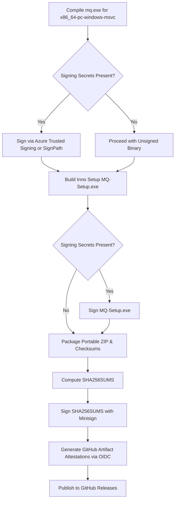

# Windows Binary Signing, SmartScreen & Attestation Guide

This document provides complete operational guidance regarding Microsoft Defender SmartScreen warnings, cryptographic release validation, GitHub Artifact Attestations, and open-source code signing integration using **SignPath Foundation** and **Azure Trusted Signing**.

---

## 1. Microsoft Defender SmartScreen & Reputation Mechanics

### 1.1 Why SmartScreen Triggers
When downloading and executing `MQ-Setup-<ver>.exe` or `mq.exe` on Windows 10 or 11, users may encounter a blue warning banner:

> **Windows protected your PC**  
> *Microsoft Defender SmartScreen prevented an unrecognized app from starting. Running this app might put your PC at risk.*  
> *(Publisher: Unknown publisher)*

Or in Russian:

> **Система Windows защитила ваш компьютер**  
> *Фильтр SmartScreen Защитника Windows предотвратил запуск неопознанного приложения. Это приложение может подвергнуть ваш компьютер риску.*  
> *(Издатель: Неизвестный издатель)*

#### The Reputation Model
1. SmartScreen does **not** indicate that malware was detected. It simply signifies that the specific binary executable hash has not yet accumulated sufficient download telemetry in Microsoft's telemetry database.
2. Unsigned binaries, self-signed binaries, and standard (non-EV) certificates all start with zero reputation.
3. Every new version or patch changes the SHA-256 hash, which temporarily resets the reputation counter until enough users have run that version worldwide.
4. Traditional hardware-token EV (Extended Validation) certificates bypass the reputation ramp-up, but cost $300–$500 annually and require dedicated physical hardware USB tokens (HSMs).

---

### 1.2 User Instructions: How to Run the Installer

#### Method A: Graphical Interface (Standard)
1. In the blue SmartScreen dialog, click **More info** (Russian: **Подробнее**).
2. Click **Run anyway** (Russian: **Выполнить в любом случае**).
3. The installer will launch normally and create shortcuts in your Start Menu.

#### Method B: File Properties (Explorer)
If Windows blocks execution or PowerShell raises an execution policy warning on a downloaded script:
1. Right-click `MQ-Setup-<ver>.exe` (or `install.ps1`).
2. Select **Properties** (Свойства).
3. At the bottom of the **General** (Общие) tab, look for the **Security** (Безопасность) notice:
   *"This file came from another computer and might be blocked to help protect this computer."*
4. Check the **Unblock** (Разблокировать) checkbox.
5. Click **Apply** -> **OK**.

#### Method C: PowerShell Unblock Command
To unblock from the terminal:
```powershell
Unblock-File -Path .\MQ-Setup-*.exe
```

---

## 2. Cryptographic Verification & Transparency

MQ provides multiple independent verification layers so that users and system administrators can verify binary integrity before execution without trusting third-party certificate authorities.

### 2.1 SHA-256 Integrity Check against `SHA256SUMS`

Every MQ release artifact is published alongside a canonical `SHA256SUMS` file.

#### In PowerShell:
```powershell
# Compute the SHA-256 hash of the downloaded installer:
(Get-FileHash .\MQ-Setup-2.3.0-x64.exe -Algorithm SHA256).Hash

# Verify automatically against SHA256SUMS:
$expected = (Get-Content .\SHA256SUMS | Select-String "MQ-Setup-2.3.0-x64.exe").Line.Split(" ")[0]
$actual   = (Get-FileHash .\MQ-Setup-2.3.0-x64.exe -Algorithm SHA256).Hash.ToLower()
if ($actual -eq $expected) {
    Write-Host "[OK] SHA-256 matches official release!" -ForegroundColor Green
} else {
    Write-Host "[FAIL] Checksum mismatch!" -ForegroundColor Red
}
```

#### In Windows Command Prompt (`cmd.exe`):
```cmd
certutil -hashfile MQ-Setup-2.2.0.exe SHA256
```

---

### 2.2 GitHub Artifact Attestations (Sigstore / OIDC)

Every official MQ release binary published by GitHub Actions includes a cryptographic **GitHub Artifact Attestation** adhering to SLSA (Supply-chain Levels for Software Artifacts) Level 3 provenance.

Attestations are signed inside GitHub's ephemeral build runners using GitHub's OIDC issuer and logged in public transparency logs (Rekor).

#### Verifying with GitHub CLI:
```powershell
# Verify that the binary was built by GitHub Actions in the MrQuster/mq repository
gh attestation verify .\MQ-Setup-2.3.0-x64.exe --owner MrQuster
```

**Expected output:**
```
Loaded digest sha256:... for MQ-Setup-2.3.0-x64.exe
Loaded 1 attestation from GitHub API
✓ Verification succeeded!

[Attestation summary]
  Repository:   MrQuster/mq
  Workflow:     .github/workflows/release.yml
  Commit:       1b1327ab498836dc3a8f3ed8a5ec5015202c3982
  Trigger:      release
```
This cryptographically guarantees:
1. The binary was built on GitHub-hosted runners, not on a personal machine.
2. The source code matches the exact audited git commit.
3. No intermediate tampering took place between compilation and download.

---

### 2.3 Minisign Verification

The `SHA256SUMS` manifest is cryptographically signed using Minisign (embedded public key `RWRlxrUOJgeLq7AIndJRG9ZhsdT5QiHy9usykXvxt1C49a1h/km3h9lt`):
```powershell
minisign -Vm SHA256SUMS -P RWRlxrUOJgeLq7AIndJRG9ZhsdT5QiHy9usykXvxt1C49a1h/km3h9lt
```
If valid, Minisign prints `Signature and comment signature verified`.

---

## 3. Automated Code Signing Integration for Open Source

To eliminate the SmartScreen prompt entirely for end-users, MQ can be signed during the release pipeline using one of two recommended solutions for open-source projects:

| Feature | SignPath Foundation | Azure Trusted Signing |
| :--- | :--- | :--- |
| **Target Audience** | Open-source GitHub projects | Enterprises & registered developers |
| **Cost** | Free (sponsored for OSS) | ~$10/month + per-signature tier |
| **Certificate Type** | Standard Authenticode via hosted HSM | Microsoft Managed Cloud Signing |
| **SmartScreen Trust** | Fast reputation buildup | **Immediate** SmartScreen trust |
| **CI Integration** | GitHub Actions (`signpath/github-action`) | GitHub Actions (`azure/trusted-signing-action`) |
| **Requirements** | Active OSS project, public repo | Azure Subscription, identity check |

---

### 3.1 Option A: SignPath Foundation (Recommended for Open Source)

[SignPath Foundation](https://about.signpath.io/programs/open-source) provides free code signing certificates stored in cloud HSMs for open-source projects.

#### Setup Steps:
1. Register project at [SignPath Foundation](https://about.signpath.io/programs/open-source).
2. Configure project policy (e.g., signing only allowed for releases tagged from `main`).
3. Add the following secrets to GitHub repository settings:
   - `SIGNPATH_API_TOKEN`: API token generated in SignPath.
   - `SIGNPATH_ORGANIZATION_ID`: Your SignPath organization identifier.
   - `SIGNPATH_PROJECT_SLUG`: `mq`.
   - `SIGNPATH_SIGNING_POLICY_SLUG`: `release-signing`.

#### GitHub Actions Workflow Example:
```yaml
- name: Submit Binary to SignPath for Signing
  uses: signpath/github-action-submit-signing-request@v1
  with:
    api-token: ${{ secrets.SIGNPATH_API_TOKEN }}
    org-id: ${{ secrets.SIGNPATH_ORGANIZATION_ID }}
    project-slug: mq
    signing-policy-slug: release-signing
    artifact-path: 'target/release/mq.exe'
    output-artifact-directory: 'signed-artifacts'
    wait-for-completion: true
```

---

### 3.2 Option B: Microsoft Azure Trusted Signing (Azure Code Signing)

Microsoft's [Azure Trusted Signing](https://learn.microsoft.com/en-us/azure/trusted-signing/) service integrates directly with Windows Defender SmartScreen, providing **instant SmartScreen reputation** from the very first download.

#### Prerequisites:
1. Azure Account with a Trusted Signing account created in your Azure tenant.
2. Identity validation completed (individual developer or organization).
3. A Certificate Profile created in Azure Trusted Signing (`Public Trust`).
4. An Azure Service Principal with `Trusted Signing Certificate Profile Signer` role.

#### GitHub Repository Secrets:
- `AZURE_CLIENT_ID`
- `AZURE_TENANT_ID`
- `AZURE_CLIENT_SECRET` (or OIDC federated credential)
- `AZURE_TRUSTED_SIGNING_ENDPOINT`: `https://eus.codesigning.azure.net`
- `AZURE_TRUSTED_SIGNING_ACCOUNT`: `<your-signing-account-name>`
- `AZURE_TRUSTED_SIGNING_PROFILE`: `<your-profile-name>`

#### GitHub Actions Workflow Example:
```yaml
- name: Azure Login
  uses: azure/login@v2
  with:
    client-id: ${{ secrets.AZURE_CLIENT_ID }}
    tenant-id: ${{ secrets.AZURE_TENANT_ID }}
    allow-no-subscriptions: true

- name: Sign Inno Setup Installer & Executable
  uses: azure/trusted-signing-action@v0.5.1
  with:
    azure-authenticode-endpoint: ${{ secrets.AZURE_TRUSTED_SIGNING_ENDPOINT }}
    trusted-signing-account-name: ${{ secrets.AZURE_TRUSTED_SIGNING_ACCOUNT }}
    certificate-profile-name: ${{ secrets.AZURE_TRUSTED_SIGNING_PROFILE }}
    files: |
      target/release/mq.exe
      dist/MQ-Setup-*.exe
    file-digest: SHA256
    timestamp-rfc3161: http://timestamp.acs.microsoft.com
    timestamp-digest: SHA256
```

---

## 4. CI/CD Release Pipeline Architecture

To ensure releases can always be published reliably regardless of external signing service status, the release pipeline is structured with graceful fallbacks:



### Key Principles:
1. **Never Fail Build if Signing Secrets are Absent**: When building from forks or local environments, builds succeed cleanly in unsigned mode.
2. **Double Provenance**: All releases, signed or unsigned, produce verifiable `SHA256SUMS`, Minisign signatures, and GitHub Artifact Attestations.
3. **User Transparency**: End-users always have cryptographic commands to verify artifact authenticity directly against the repository commits.
